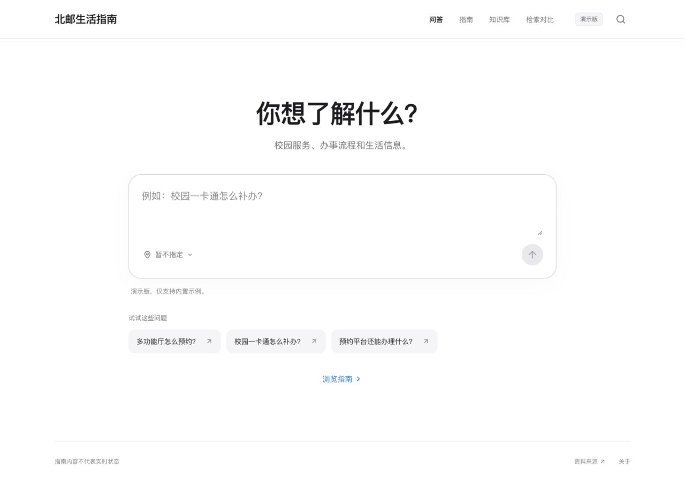
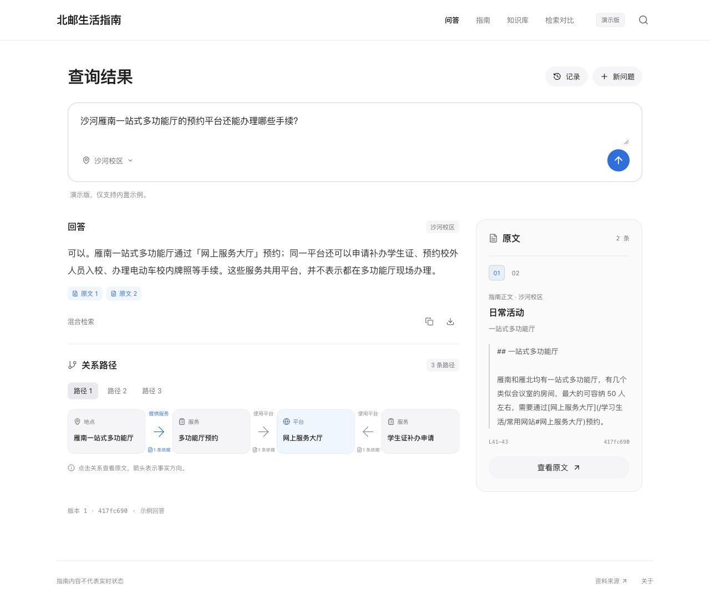
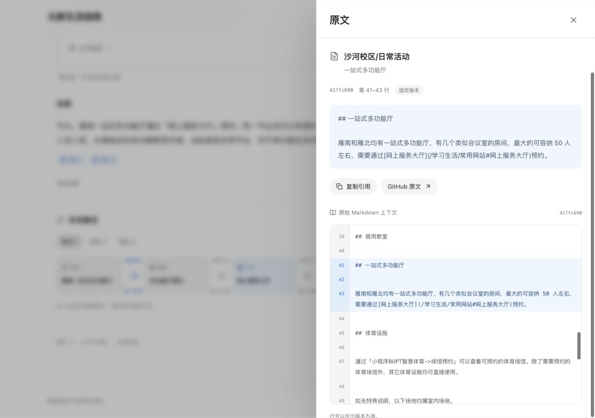
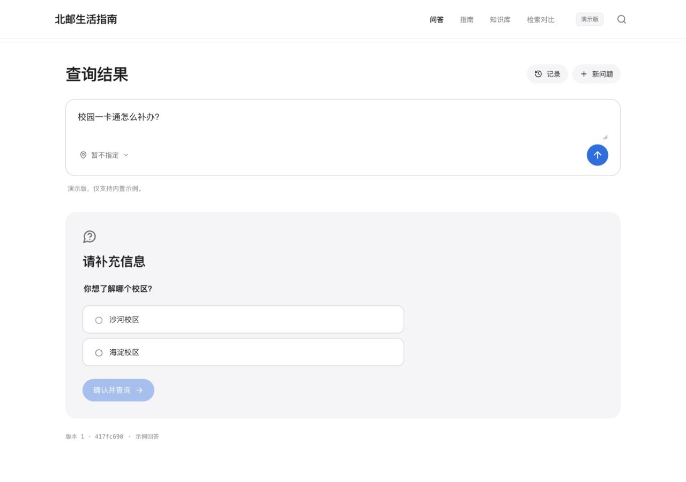
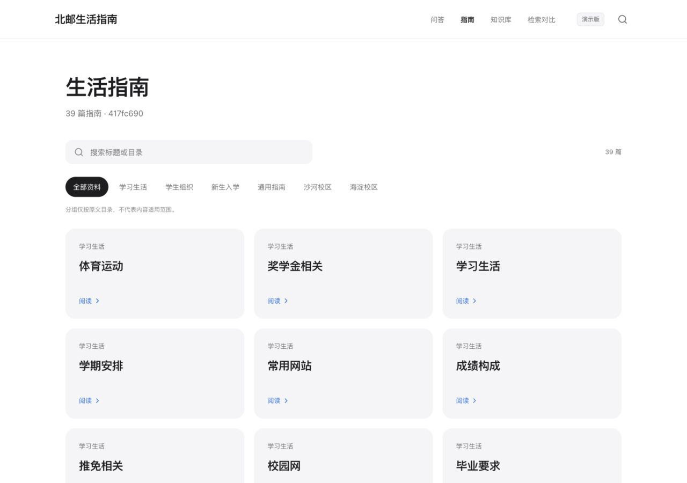
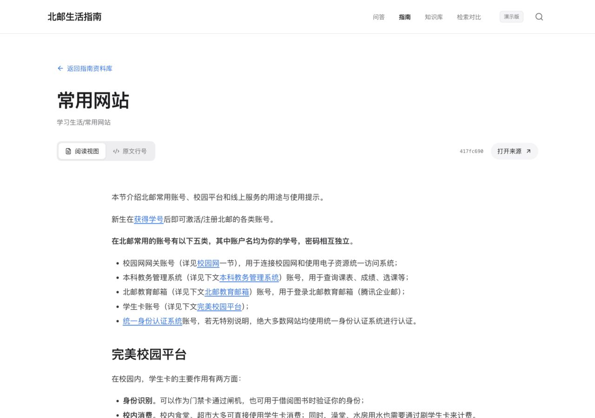
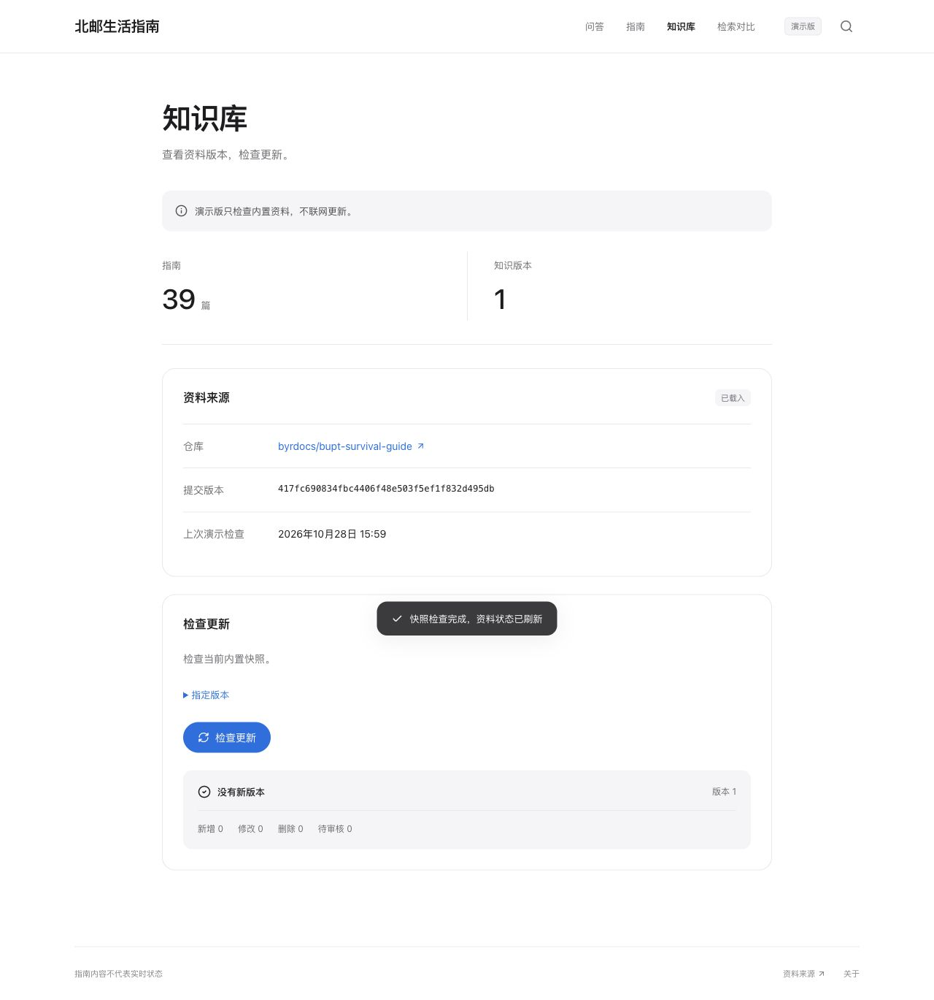
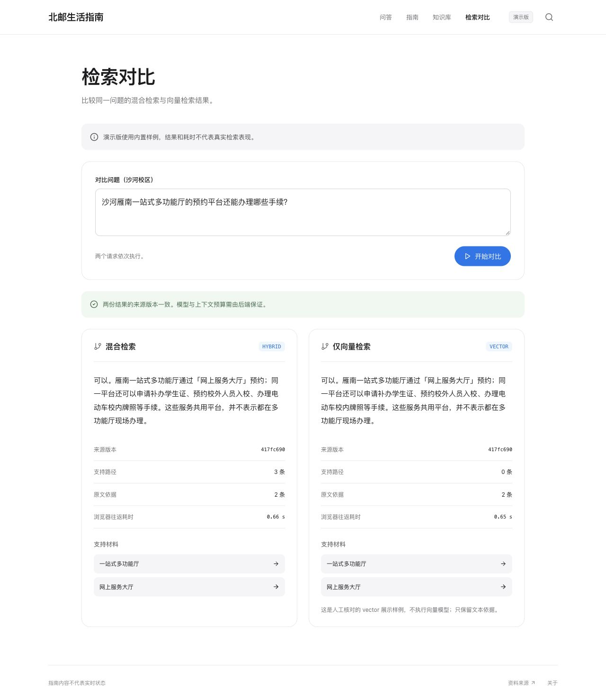
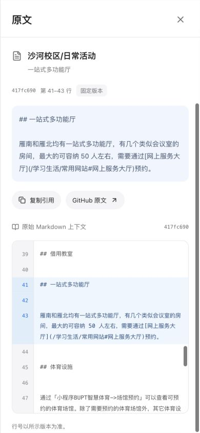

> 整合更新：本文保留原始前端交接记录。当前默认真实接口，预览服务已支持 API 代理，使用方式与验证结论请看 [当前 README](../README.md) 和 [全栈运行说明](../../docs/integration.md)。

# 前端展示

在项目根目录执行 `npm start`，打开 http://127.0.0.1:4173。已包含 dist，无需安装第三方依赖即可演示；需要 Node.js 22.12 或更高版本。

完整讲解顺序见 [五分钟演示脚本](DEMO.md)，接入和维护见 [交接文档](HANDOFF.md)。项目根目录的“展示.html”可直接打开浏览截图。

以下为真实浏览器截图。页面默认 demo；指南正文来自固定版本的真实仓库，问答为有限人工核对示例。

## 1. 工作台

白色背景、系统字体、简洁顶部导航。首屏只保留提问、校区、常见问题和指南入口。

## 2. 答案、关系与证据

同一屏组织结论、三跳关系、路径切换与原文。逆向遍历仍保留事实箭头方向。

## 3. 固定版本原文

引文、commit、源行号和原文上下文联动，避免使用更新后的资料解释旧回答。

## 4. 先澄清，再回答

校区或名称不明确时先补充信息，再重发完整请求。

## 5. 资料库与阅读

真实 39 篇指南正文，按标题/路径搜索，支持阅读和原文行号。

## 6. 知识状态

查看资料版本和更新结果；指定版本默认收起，不显示虚构的进度。

## 7. 检索对比实验

hybrid/vector 顺序对比，校验版本。此演示不是模型评测。

## 8. 手机适配

窄屏将答案、路径、原文分为页签，路径竖排，保留完整证据核查。

