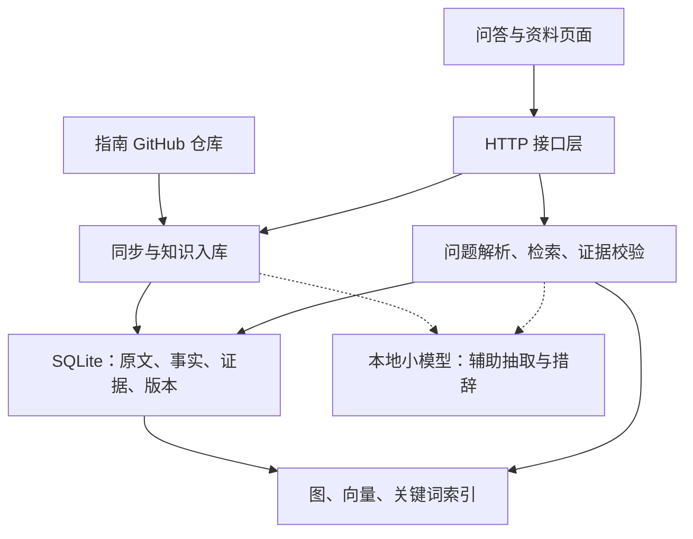

# 北京邮电大学生活指南 GraphRAG 总体架构设计、可能的技术方案与接口约定

## 1. 项目目标与资料范围

面向北京邮电大学学生，回答住宿、餐饮、交通、校园网络、办事流程等生活问题。回答应包含**结论、原文依据；涉及关联查询时，同时展示图路径**。

唯一资料源为 [byrdocs/bupt-survival-guide](https://github.com/byrdocs/bupt-survival-guide)。本次核对的版本为 [417fc690](https://github.com/byrdocs/bupt-survival-guide/commit/417fc690834fbc4406f48e503f5ef1f832d495db)：`src/content/docs/` 下有 42 个 Markdown/MDX 文件，排除首页、贡献说明、致谢后，首版纳入 **39 篇业务正文**，覆盖沙河与海淀校区及通用主题。

其余约束延续：8GB～16GB 内存笔记本、小型 Embedding、1.5B～3B 量化模型、30～50 篇资料、3～5 类实体与关系；一周内完成混合检索、多跳查询、证据链、增量更新，准备 60～80 道测试题。

## 2. 总体架构

采用**前后端分离的模块化单体架构**：浏览器负责交互，一个 Python 后端负责业务，数据保存在本机。原仓库作为只读资料源，问答系统独立开发。



| 模块 | 职责 | 输出 |
|---|---|---|
| 同步与入库 | 固定仓库版本，解析正文，抽取并审核事实，处理变更 | 原文、图事实、证据、同步报告 |
| 检索 | 按校区筛选，执行关键词、向量和图路径查询 | 相关片段、完整路径 |
| 问答编排 | 识别俗称和问题类型，安排查询步骤，核验结论 | 答案、来源、路径或拒答原因 |
| 接口层 | 校验请求，调用业务模块，统一错误与响应结构 | 本文约定的 JSON |
| 前端 | 提问、选择校区、处理歧义、展示原文与路径、查看同步状态 | 用户问题与选择 |

**模块边界：**前端不自行推理关系；SQLite 是持久化事实来源，内存图和索引可以恢复。首版后端使用单进程、串行任务队列，同步与问答不交错执行，防止混用新旧知识。

## 3. 可行技术方案

### 3.1 技术选择

| 用途 | 首版选择 | 说明 |
|---|---|---|
| 前端与接口 | Vue 3 + TypeScript；Python + FastAPI + Pydantic | 已有前端可沿用；后端生成 OpenAPI 供双方对接 |
| 数据与图 | SQLite + NetworkX `MultiDiGraph` | 保存来源与版本，在内存中遍历有向关系 |
| 语义检索 | [bge-small-zh-v1.5](https://huggingface.co/BAAI/bge-small-zh-v1.5) + NumPy | 中文模型输出 512 维；本规模直接计算余弦相似度 |
| 关键词检索 | BM25 + 中文分词及校园词典 | 保留“雁南”“学活”等名称，补足精确匹配 |
| 小语言模型 | [Qwen2.5-1.5B-Instruct-GGUF](https://huggingface.co/Qwen/Qwen2.5-1.5B-Instruct-GGUF)，Q4_K_M，llama.cpp | 辅助候选抽取和措辞，关系成立与否由证据校验决定 |

先验证 1.5B 配置，3B 作为内存允许时的扩展。Embedding 与生成串行运行，向量缓存复用；模型与依赖版本在联调后锁定。内存和耗时以目标笔记本实测为准。

### 3.2 资料处理与更新

1. **固定快照：**每次同步先把 `main` 或指定提交解析为完整 commit SHA，再读取该版本的正文。只读取配置中的正文范围，不自动抓取外链网站。
2. **解析正文：**保留标题层级、表格、提示块和原文件行号；跳过代码、HTML 注释、脚本及图片识别。仓库内写给机器人的指令不参与问答控制。图片和外链可以展示为来源链接，不能据此补写未读取的内容。
3. **抽取事实：**按段落、句子切分，并检查实际 token 长度；规则优先，小模型补充候选。关系必须有原文支撑；不确定候选经人工审核后才入图，首版使用命令行审核即可。课程说明、经验建议等不适合建图的内容继续走文本检索。
4. **增量更新：**按仓库路径识别文档，内容哈希判断变化；只重算变化片段的向量和相关事实。改名按旧文件删除、新文件新增处理。撤回旧证据时，仍有其他有效来源的事实保留。

所有文件成功读取、解析并准备好索引后，才发布新 `knowledge_revision`；失败保留旧版本，不能把下载失败当作文件删除。同一提交和配置重复同步不重复入库。历史原文保留，旧证据退出当前检索；更换 Embedding 模型需重建向量索引。

### 3.3 知识图谱：五类实体、四类关系

| 实体类型 | 含义 | 例子 |
|---|---|---|
| `Campus` | 校区 | 沙河校区、海淀校区 |
| `Place` | 具体地点或设施 | 沙河雁南一站式多功能厅、海淀综合服务大厅 |
| `Service` | 具体办理或使用事项 | 多功能厅预约、学生证补办申请 |
| `Platform` | 网站、App、公众号等入口 | 网上服务大厅、完美校园 |
| `Condition` | 办理或使用条件 | 校园网环境、携带身份证或输入身份证号 |

| 关系名 | 方向 | 含义 |
|---|---|---|
| `LOCATED_IN` | Place → Place / Campus | 地点位于另一地点或校区 |
| `PROVIDES` | Place → Service | 此地点提供某项服务 |
| `USES_PLATFORM` | Service → Platform | 通过该平台办理或使用服务 |
| `REQUIRES` | Service / Platform → Condition | 在原文注明的阶段需要满足条件 |

实体使用稳定 ID。**服务须区分校区和办理地点**，不能把两校区不同规则合并成一个“补卡”节点。平台结合名称与规范 URL 归一，可跨校区共用。营业时间、费用等作为带证据的属性或文本保留，不再扩展实体类别。

别名先从正文和《行话辞典》整理，再人工确认：“本部／西土城路校区”可对应海淀校区；“学活”在两校区都有，不能直接确定地点；“校园卡”可能指学生卡或电话卡，需要根据上下文澄清。

目录仅提示资料范围，不能把文中提到的外校区地点也归到当前校区。保留否定、例外和适用阶段：“不能洗鞋”不是提供洗鞋服务；“身份证或身份证号”不是两者都要；“使用时需要”不等于“预约前必须”。同一范围内的矛盾证据须标记冲突，不自动挑一条当答案。

### 3.4 混合检索与多跳查询

- **普通说明题：**校区筛选后，向量与 BM25 各取前 10 个片段，按片段 ID 用 RRF 融合，取前 10。每路贡献 `1/(60+名次)`，名次从 1 开始，未命中贡献 0。
- **关联题：**同时执行上述文本检索，并匹配预设模板，按指定关系和方向查图；图路径决定关联是否成立，文本补充说明。支持正向、逆向、两跳、三跳及两条查询分支取交集；最多 3 跳、50 条完整路径、1000 次边展开，未搜索完即触及限制时标记 `partial`。
- **回答校验：**关联答案必须有完整路径，每条边有有效证据；路径证据不受文本 Top10 限制。文本题也要有直接支持结论的原文。先用模板生成答案，小模型可润色；无法容纳全部必要证据或润色增加无依据事实时退回模板。

校区筛选同时保留明确适用于全校的资料；范围未知不等于全校通用。缺少必要校区、问题与所选校区冲突或实体有歧义时先澄清。单纯共现、超链接、同属一个栏目不能自动变成业务关系。

**有真实原文支撑的查询模板：**

| 问题类型 | 图查询方式 |
|---|---|
| 某地点提供什么服务、在哪里 | `PROVIDES`、`LOCATED_IN` 的单跳或组合 |
| 某地点的服务通过什么平台办理 | Place → Service → Platform，两跳 |
| 某服务的平台有什么使用条件 | Service → Platform → Condition，两跳 |
| 某地点服务所用的平台，还能办理什么 | Place → Service → Platform ← Service，三跳 |

例如：“沙河雁南一站式多功能厅的预约平台，还能办理哪些手续？”可得到路径：**多功能厅 → 预约服务 → 网上服务大厅 ← 学生证补办申请**。前两跳依据[《沙河校区／日常活动》](https://github.com/byrdocs/bupt-survival-guide/blob/417fc690834fbc4406f48e503f5ef1f832d495db/src/content/docs/沙河校区/日常活动.md#L41-L43)，第三跳依据[《学习生活／常用网站》](https://github.com/byrdocs/bupt-survival-guide/blob/417fc690834fbc4406f48e503f5ef1f832d495db/src/content/docs/学习生活/常用网站.md#L112-L120)。这说明两项服务共用平台，不表示补办学生证要去多功能厅。

## 4. 接口与数据定义

### 4.1 公共数据结构

以下字段默认必填；所有 ID 和文本为字符串，版本与行号为整数；`[]` 表示数组，空数组仍返回 `[]`。实体的 `campus` 取 `shahe`、`haidian`、`shared` 或 `unknown`。

| 对象 | 字段与说明 |
|---|---|
| `Document` | `id, title, source_path, source_commit, source_url`；标题含栏目，避免两个“生活服务”重名 |
| `Entity` | `id, type, name, aliases[], campus, url`；类型限定为上述五类，`url` 仅取原文提供的链接，无链接为 `null` |
| `Edge` | `subject_id, relation, object_id, evidence_ids[]`；始终保存事实的规范方向 |
| `Evidence` | `id, doc_id, source_commit, source_path, heading, line_start, line_end, quote, source_url` |
| `Path` | `id, branch_id, nodes: Entity[], edges: Edge[]`；普通查询分支为 0，交集为 0、1 |
| `Answer` | `text, entity_ids[], path_ids[], evidence_ids[]`；一条结论关联其支持材料 |

路径节点按实际遍历顺序排列，边连接相邻节点；逆向遍历不颠倒边的事实方向。交集答案必须提供两个分支的完整支持。

证据行号以**该 commit 下未经清洗的 Markdown 原文件**为准，从 1 开始且两端包含。`quote` 必须能在相应行范围中逐字找到；清洗、分块不能改变原文定位。`source_url` 使用固定提交链接：`https://github.com/byrdocs/bupt-survival-guide/blob/{commit}/{path}#L{start}-L{end}`。前端以安全文本展示引文，不执行原文 HTML。

### 4.2 HTTP 接口

统一前缀 `/api/v1`，请求与响应使用 JSON。首版同步采用等待完成后返回的方式，前端显示处理中状态。

| 方法与路径 | 输入 | 成功返回 |
|---|---|---|
| `POST /knowledge/sync` | `{ref}`，默认 `main`，也可指定完整 commit SHA；仓库固定 | `{source_commit, knowledge_revision, added, updated, deleted, pending_count, changed}` |
| `GET /knowledge/status` | 无 | `{repository, source_commit, knowledge_revision, document_count, last_synced_at}` |
| `GET /documents` | 无 | `{items: Document[]}`，当前版本的正文清单 |
| `GET /documents/{doc_id}` | 可选 `source_commit`，默认当前版本 | `{document: Document, text}`，`text` 为原始 Markdown |
| `GET /entities` | 可选 `q` 和 `campus` | `{items: Entity[]}`，匹配名称及别名 |
| `POST /qa` | 下述问答请求 | 下述 `QAResponse` |

`doc_id` 由后端按“仓库＋文件路径”稳定生成；同步只更新本地知识库。计数为非负整数，`changed` 为布尔值，表示是否发布了新知识版本；`pending_count` 为待人工审核候选数。尚未导入时版本和数量为 0，`source_commit/last_synced_at=null`；同步时间使用带时区的 ISO 8601 字符串，不代表事实已获最新确认。

### 4.3 问答请求与响应

```json
{
  "question": "雁南一站式多功能厅的预约平台还能办理哪些手续？",
  "campus": "shahe",
  "mode": "hybrid",
  "entity_bindings": {}
}
```

`question` 必填且非空；`campus` 为 `shahe`、`haidian` 或 `null`，默认 `null`；实体查询接口使用相同校区筛选。`mode` 默认 `hybrid`，另有评测用的 `vector`，只执行向量检索，不使用图或 BM25；校区筛选与语料保持一致。`entity_bindings` 默认 `{}`，用“问题中的名称 → 所选实体 ID”传递澄清结果，后端校验所选实体。

`QAResponse` 固定返回以下字段：

| 字段 | 类型与用途 |
|---|---|
| `status, reason` | 字符串状态及原因码，见下表；正常回答的 `reason=null` |
| `knowledge_revision, source_commit` | 整数版本、完整提交 SHA，标识回答所依据的资料快照 |
| `answers, paths, evidence` | 分别为 `Answer[]`、`Path[]`、`Evidence[]` |
| `warnings` | 字符串数组；提示时间敏感、适用范围等限制 |
| `clarifications` | `{field, mention, options:[{value,label}]}[]`；`field` 为 `campus` 或 `entity_bindings` |

澄清校区时，选项 `value` 为 `shahe/haidian`；澄清实体时为实体 ID，`mention` 指明写入 `entity_bindings` 的键。前端选择后重发完整请求；校区澄清的 `mention` 可为空字符串。

| 状态 | 原因码 | 展示要求 |
|---|---|---|
| `answered` | `null` | 答案及原文；关联题同时展示路径 |
| `partial` | `search_truncated`、`conflicting_evidence` | 只展示已支持部分，提示结果可能不完整 |
| `abstained` | `no_evidence`、`unknown_entity`、`unsupported_query`、`realtime_unavailable` | 说明无法确认，不把“未找到”说成“不存在” |
| `needs_clarification` | `campus_required`、`ambiguous_entity` | 展示选项，请用户补充校区或实体 |

所有业务状态均返回 HTTP 200。拒答和待澄清时 `answers=[]`，`partial` 也可为空；文本题和 `vector` 模式的 `paths=[]`，仍须提供支持答案的证据。前端常驻显示“依据指南快照”；营业时间、价格等附时效提醒，明确询问实时状态时返回 `realtime_unavailable`。

请求不合法返回 422，文档或已保存版本不存在返回 404，资料源／必要模型不可用或知识库未初始化返回 503，其他服务错误返回 500。错误体统一为 `{error:{code,message}}`，两个字段均为字符串；源站失败不影响已有快照的问答。

## 5. 分工与验收

| 负责人 | 交付内容 |
|---|---|
| 后端同学1 | 正文清单、校区别名、人工确认的事实、查询模板、证据映射 |
| 后端同学2 | 三路检索、多跳执行、同步更新、HTTP 接口、OpenAPI 和四类状态示例 |
| 前端同学 | 问答与资料页、校区选择、歧义确认、证据路径展示、同步状态 |

测试同学的测试建议：

1. 能回答真实的两跳、三跳、逆向及交集问题；至少包含跨两份正文的完整路径，每一跳均能打开固定版本的原文。
2. 校区、俗称、办理条件不混淆；没有来源的图边、实时状态和图片信息不得编造。
3. 增删改同步、重复同步、失败回滚、共享证据保留、重启恢复均正确；未变片段不重复编码。
4. 准备 60～80 道基于该仓库的题，覆盖事实、多跳、澄清、冲突和不可回答场景；标注答案及必要证据。朴素 RAG 与 GraphRAG 使用同一快照、模型和固定上下文预算，对比答案正确率、完整证据链比例、拒答率、延迟和峰值内存。完整证据链按“所需证据全部齐全的回答数／可回答题数”计算，不以有一个引用代替。测试结果在真实模型与目标笔记本运行后填写。
